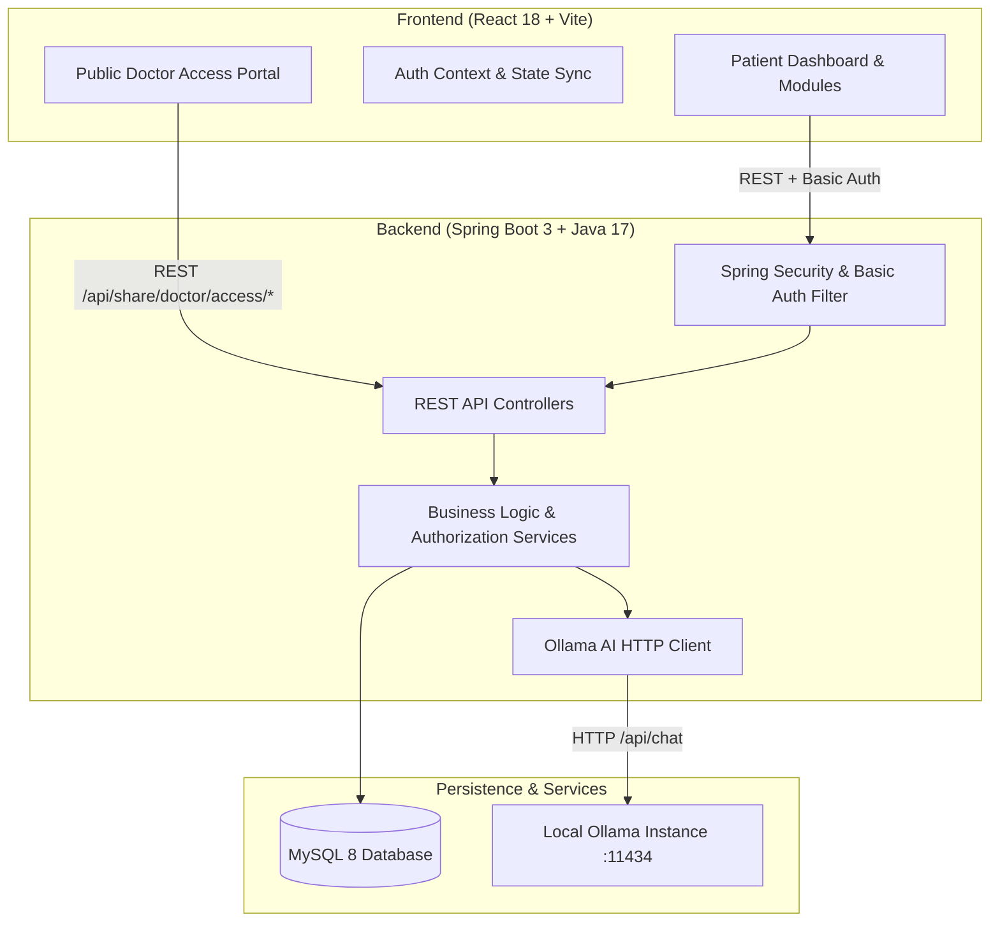

# Centralized Health Passport — Comprehensive Project Documentation

## 1. Executive Summary

The **Centralized Health Passport** (HealthBro) is a patient-centric, privacy-first digital healthcare management platform. It bridges the gap between fragmented patient records and medical interoperability by offering:
- **Patient Data Sovereignty:** Complete ownership, viewing, editing, and deletion controls over personal medical records.
- **Granular Consent Circles:** Family health sharing networks where records are private by default and require deliberate, per-user consent grants.
- **Time-Bound Ephemeral Doctor Sharing:** Secure, cryptographically protected temporary sharing codes allowing clinicians read-only access to select records without account creation.
- **Personal Health Timeline & Emergency Health Card:** Chronological clinical overview and first-responder critical emergency information.
- **Privacy-Preserving Health Intelligence:** Family disease clustering notices and aggregated community health trends using $k$-anonymity thresholding ($k \ge 3$) without personal data disclosure.
- **Local-Only AI Medical Summarization:** On-premise record synthesis powered by a local Ollama instance (`llama3.2:3b`), ensuring zero Protected Health Information (PHI) leaves the host machine.

---

## 2. High-Level System Architecture



---

## 3. Technology Stack

### Frontend
- **Framework & Tooling:** React 18, Vite 5, JavaScript (ES modules)
- **Routing:** React Router v6
- **HTTP Client:** Axios (configured with interceptors, credentials, and custom envelope handlers)
- **Styling:** Custom Vanilla CSS design system with CSS custom properties (variables), clean medical aesthetic, glassmorphism, responsive flex/grid layouts, and accessibility support.
- **State Management:** React Context API (`AuthContext`) handling session persistence, user profiles, credentials, and logout flows.

### Backend
- **Language & Runtime:** Java 17+, Spring Boot 3.x
- **Build Tool:** Apache Maven
- **Security:** Spring Security (HTTP Basic with BCrypt password hashing for academic foundation, CORS filter, CSRF disabled for REST APIs, custom EntryPoint)
- **Data Persistence:** Spring Data JPA / Hibernate ORM
- **Database:** MySQL 8.0+ for runtime; H2 in-memory database for automated integration test suites (`mvn test`)
- **Validation:** Jakarta Bean Validation (`@Valid`, `@NotBlank`, `@Size`, `@Pattern`)
- **AI Integration:** Spring WebClient / REST HTTP client communicating with local Ollama daemon (`http://localhost:11434`)

---

## 4. Database Schema & Data Models

| Entity | Table Name | Key Attributes | Constraints & Relationships |
|---|---|---|---|
| **User** | `users` | `id`, `fullName`, `email`, `passwordHash`, `createdAt` | Unique index on `email`. Passwords hashed with BCrypt. |
| **MedicalRecord** | `medical_records` | `id`, `user_id`, `title`, `category`, `provider`, `recordDate`, `notes`, `createdAt` | Many-to-One with `User`. Indexed on `user_id`. |
| **FamilyGroup** | `family_groups` | `id`, `name`, `owner_user_id`, `createdAt` | Many-to-One with `User` (owner). |
| **FamilyMembership** | `family_memberships` | `id`, `group_id`, `user_id`, `role`, `status`, `recordAccessGranted` | Status: `PENDING`, `APPROVED`, `REJECTED`. Unique `(group_id, user_id)`. |
| **FamilyInvitation** | `family_invitations` | `id`, `group_id`, `tokenHash`, `expiresAt`, `revoked` | High-entropy random code stored strictly as SHA-256 hash. 7-day default expiry. |
| **DoctorShareSession** | `doctor_share_sessions` | `id`, `user_id`, `codeHash`, `authorizedRecordIds`, `expiresAt`, `revoked`, `createdAt` | SHA-256 hash storage. `authorizedRecordIds` stored as delimited string / set. |
| **EmergencyHealthCard** | `emergency_health_cards` | `id`, `user_id`, `bloodGroup`, `allergies`, `medications`, `existingConditions`, `emergencyContactName`, `emergencyContactPhone`, `emergencyContactRelation`, `notes` | One-to-One strictly mapped to `User`. |
| **CommunityHealthConsent** | `community_health_consents` | `id`, `user_id`, `consented`, `updatedAt` | One-to-One with `User`. Controls inclusion in community-level aggregated trends. |
| **AiHealthSummary** | `ai_health_summaries` | `id`, `record_id`, `user_id`, `summaryText`, `sectionsJson`, `modelName`, `createdAt`, `updatedAt` | Unique constraint on `record_id` (one cached summary per record). |

---

## 5. Core Product Features & Architectural Deep-Dives

### 5.1 Patient Account & Record Management
- **Self-Service Authentication:** Registration normalizes email, checks uniqueness, and saves BCrypt-encrypted credentials.
- **Record Metadata Lifecycle:** Patients log clinical events across categories (Lab results, Prescriptions, Imaging, Clinical notes, Vaccinations).
- **Strict Tenant Isolation:** All operations enforce that `record.getUser().getId().equals(currentUser.getId())`. Unauthorized requests result in strict 404 or 403 responses.

### 5.2 Family Health Network
- **Circle Creation & Invitation Codes:** Circle owner generates high-entropy cryptographic invitation codes. Only the SHA-256 hash is saved.
- **Two-Step Join & Approval:** A join request sets status to `PENDING`. Circle owner must explicitly approve or reject members.
- **Explicit Record Privacy Boundary:** Joining a family group **never** exposes records automatically (`recordAccessGranted = false` by default). Each member must manually toggle consent on `/family`.
- **Immediate Revocation:** Toggling consent off instantly severs access to records and excludes data from Family Insights.

### 5.3 Secure Doctor Sharing Portal
- **Granular Record Selection:** The patient selects specific records to share instead of exposing their complete medical history.
- **Configurable Expiry & Secure Random Codes:** Generates a 12-character alphanumeric code via `SecureRandom` with expiration periods ranging from 15 minutes to 7 days.
- **Zero Plaintext Storage:** Backend hashes the code with SHA-256 before persisting.
- **Dedicated Public Portal (`/doctor-access`):** Doctors access records via code without requiring an account or patient credentials. Rate-limited per IP to prevent brute-force attacks.
- **One-Click Patient Revocation:** Patients can terminate an active session immediately from the dashboard.

### 5.4 Personal Health Timeline & Emergency Health Card
- **Chronological Timeline (`/timeline`):** Dynamic sorting (newest first), category chips, date range filtering, and comprehensive modal inspect views.
- **Emergency Health Card (`/emergency-card`):** Captures critical first-responder data (blood group, life-threatening allergies, current medications, emergency contact). Kept private to the authenticated user and excluded from public endpoints.

### 5.5 Family & Community Health Intelligence
- **Family Health Insights (`/insights`):** Detects condition clusters across consenting members. Requires $\ge 2$ consenting members to prevent single-member de-anonymization. Includes disclaimers on biological vs non-biological ties.
- **Community Health Intelligence (`/community`):** Anonymized cross-cohort metrics. Requires explicit user opt-in (`/api/community/consent`). Enforces $k$-anonymity threshold ($k \ge 3$ unique patients per category); categories below threshold are suppressed.

### 5.6 On-Premise AI Health Summarization
- **Zero-Cloud Privacy:** Direct HTTP integration with local Ollama daemon (`llama3.2:3b`).
- **Structured 7-Section Clinical Breakdown:**
  1. Plain-Language Overview
  2. Key Findings Mentioned in Document
  3. Measurements, Lab Values & Reference Ranges (exact preservation)
  4. Medications Mentioned
  5. Follow-up Instructions
  6. Questions to Ask Your Doctor
  7. Missing Information / Not Specified
- **Summary Caching & Force Refresh:** Persists generated summaries in `ai_health_summaries` to eliminate unnecessary re-computations while supporting user-triggered re-runs.

---

## 6. Complete API Reference

All endpoints return a standardized envelope:
```json
{
  "success": true,
  "message": "Operation description",
  "data": { ... },
  "timestamp": "2026-10-25T12:00:00Z"
}
```

### 6.1 Authentication & Profile
| Method | Endpoint | Authorization | Description |
|---|---|---|---|
| `GET` | `/api/health` | Public | System status and database liveness |
| `POST` | `/api/users/register` | Public | Register new user account |
| `GET` | `/api/users/me` | Authenticated | Fetch authenticated user profile |

### 6.2 Medical Records
| Method | Endpoint | Authorization | Description |
|---|---|---|---|
| `GET` | `/api/records` | Authenticated | List all medical records owned by user |
| `POST` | `/api/records` | Authenticated | Create a new medical record |
| `GET` | `/api/records/{id}` | Authenticated (Owner) | Get details of a single record |
| `PUT` | `/api/records/{id}` | Authenticated (Owner) | Update an existing medical record |
| `DELETE` | `/api/records/{id}` | Authenticated (Owner) | Delete a medical record |

### 6.3 Family Health Circles
| Method | Endpoint | Authorization | Description |
|---|---|---|---|
| `POST` | `/api/family` | Authenticated | Create family group and generate invite code |
| `GET` | `/api/family` | Authenticated | List family groups user is member/owner of |
| `GET` | `/api/family/{id}` | Authenticated (Member) | Get family group overview and members |
| `POST` | `/api/family/join` | Authenticated | Submit join request using invite code |
| `POST` | `/api/family/{id}/invitations/regenerate` | Authenticated (Owner) | Invalidate current invite and issue new one |
| `POST` | `/api/family/{id}/invitations/revoke` | Authenticated (Owner) | Revoke active family invite code |
| `POST` | `/api/family/{id}/members/{memId}/accept` | Authenticated (Owner) | Approve pending join request |
| `POST` | `/api/family/{id}/members/{memId}/reject` | Authenticated (Owner) | Reject pending join request |
| `DELETE` | `/api/family/{id}/members/{memId}` | Owner / Self | Remove member or leave family group |
| `PUT` | `/api/family/{id}/consent` | Authenticated (Member) | Grant or revoke record sharing consent |
| `GET` | `/api/family/{id}/members/{userId}/records` | Consented Member | View consented member's records |
| `GET` | `/api/family/{groupId}/insights` | Authenticated (Member) | Aggregated health pattern observations |

### 6.4 Doctor Sharing Sessions
| Method | Endpoint | Authorization | Description |
|---|---|---|---|
| `POST` | `/api/share/doctor/sessions` | Authenticated (Owner) | Create doctor share session with record list & expiry |
| `GET` | `/api/share/doctor/sessions` | Authenticated (Owner) | List active and historical share sessions |
| `DELETE` | `/api/share/doctor/sessions/{id}` | Authenticated (Owner) | Immediately revoke active sharing session |
| `POST` | `/api/share/doctor/access/validate` | Public (Rate-limited) | Doctor validates sharing code & receives records |
| `GET` | `/api/share/doctor/access/records/{recId}?code={c}` | Public (Rate-limited) | Doctor retrieves single report detail |

### 6.5 Emergency Card & Timeline
| Method | Endpoint | Authorization | Description |
|---|---|---|---|
| `GET` | `/api/emergency-card` | Authenticated (Owner) | Fetch user's private emergency health card |
| `PUT` | `/api/emergency-card` | Authenticated (Owner) | Save / update emergency health card |

### 6.6 Community Health Intelligence
| Method | Endpoint | Authorization | Description |
|---|---|---|---|
| `GET` | `/api/community/consent` | Authenticated | Get user's community aggregation opt-in status |
| `PUT` | `/api/community/consent` | Authenticated | Opt in or withdraw consent for community analytics |
| `GET` | `/api/community/insights` | Authenticated | View aggregated community patterns ($k \ge 3$) |

### 6.7 Local AI Health Summarizer
| Method | Endpoint | Authorization | Description |
|---|---|---|---|
| `GET` | `/api/ai/status` | Authenticated | Check Ollama connection, base URL, and active model |
| `GET` | `/api/ai/records/{id}/summary` | Authenticated (Owner) | Fetch existing cached summary for record |
| `POST` | `/api/ai/records/{id}/summary` | Authenticated (Owner) | Generate or force-refresh record summary via Ollama |

---

## 7. Frontend Architecture & Page Directory

```text
frontend/src/
├── components/          # Shared components (Navbar, Sidebar, Modals, Cards, Alerts)
├── context/
│   └── AuthContext.jsx  # Authentication state, login/logout, user credentials
├── layouts/
│   ├── AppLayout.jsx    # Authenticated app shell with sidebar, header, and route outlet
│   └── PublicLayout.jsx # Clean layout for login, register, and public doctor portal
├── pages/
│   ├── DashboardPage.jsx      # Overview widgets, metrics, quick actions
│   ├── RecordsPage.jsx        # Records table, category filter, record creation modal
│   ├── TimelinePage.jsx       # Chronological timeline view with date filters
│   ├── FamilyPage.jsx         # Family circles, invitation codes, membership approval, consent toggles
│   ├── SharePage.jsx          # Doctor sharing session management & code generation
│   ├── DoctorAccessPage.jsx   # Public clinician portal for report viewing & downloading
│   ├── EmergencyCardPage.jsx  # First-responder critical emergency profile
│   ├── InsightsPage.jsx       # Aggregated family health patterns & genetic disclaimers
│   ├── CommunityPage.jsx      # Community trends, opt-in consent, and suppressed aggregates
│   ├── AiSummaryPage.jsx      # Ollama AI status, record selection, structured summary display
│   ├── LoginPage.jsx          # User sign-in
│   ├── RegisterPage.jsx       # User registration
│   └── SettingsPage.jsx       # Account details and application preferences
├── services/
│   └── api.js                 # Axios instance with auth headers and error handling
└── styles/
    └── index.css              # Global design system, CSS variables, utility classes
```

---

## 8. Setup & Development Guide

### Prerequisites
- **Node.js:** v18+ and `npm`
- **Java:** JDK 17+
- **Build Tool:** Apache Maven 3.9+
- **Database:** MySQL 8.0+
- **Local AI (Optional for Phase 7):** [Ollama](https://ollama.com/) with `llama3.2:3b`

### Database Initialization
```sql
CREATE DATABASE centralized_health_passport;
CREATE USER 'health_passport_user'@'localhost' IDENTIFIED BY 'your-secure-password';
GRANT ALL PRIVILEGES ON centralized_health_passport.* TO 'health_passport_user'@'localhost';
FLUSH PRIVILEGES;
```

### Environment Variables
Configure the following environment variables (via shell or IDE run configurations):

| Variable | Default Value | Description |
|---|---|---|
| `DB_URL` | `jdbc:mysql://localhost:3306/centralized_health_passport?createDatabaseIfNotExist=true&useSSL=false&allowPublicKeyRetrieval=true&serverTimezone=UTC` | MySQL connection string |
| `DB_USERNAME` | `health_passport_user` | Database username |
| `DB_PASSWORD` | *(empty)* | Database password |
| `FRONTEND_ORIGIN` | `http://localhost:5173` | Allowed CORS origin |
| `OLLAMA_BASE_URL` | `http://localhost:11434` | Local Ollama endpoint |
| `OLLAMA_MODEL` | `llama3.2:3b` | Target LLM model |

### Running the Backend
```powershell
cd backend
mvn spring-boot:run
```
Backend will start on `http://localhost:8080`.

### Running the Frontend
```powershell
cd frontend
npm install
npm run dev
```
Frontend will be accessible at `http://localhost:5173`.

### Ollama Setup
```powershell
ollama serve
ollama pull llama3.2:3b
```

---

## 9. Security, Privacy & Compliance Design

1. **Cryptographic Protection of Access Codes:**
   - Invitation tokens and doctor sharing codes are generated using `java.security.SecureRandom`.
   - Only the one-way SHA-256 digest is persisted. Plaintext tokens exist solely in memory during generation and delivery.
2. **Strict Consent-Driven Authorization:**
   - Group membership does not equate to data access. Record sharing requires positive opt-in.
   - Immediate revocation ensures that session termination takes effect instantly across all read paths.
3. **Local AI Inference Boundary:**
   - LLM processing runs strictly on localhost (`11434`). Zero PHI is transmitted across public internet APIs.
4. **De-Identification & Aggregation Safeguards:**
   - Community metrics require $k \ge 3$ contributors per category; smaller cells are masked to prevent differencing attacks.
   - Family insights display aggregated condition categories rather than raw records.
5. **Clinical & Prototype Disclaimers:**
   - Prominent warnings highlight that self-reported emergency data does not replace dispatch services, family patterns do not constitute genetic testing, and AI summaries are strictly informational.

---

## 10. Automated Testing & Verification

The project includes unit and integration tests across both layers:

```powershell
# Frontend build & lint check
cd frontend
npm run build

# Backend full integration test suite
cd ../backend
mvn test
```

The Spring Boot test suite exercises:
- User registration and password hashing
- Scoped medical record CRUD
- Family circle lifecycle, code generation, approval flow, and consent boundaries
- Ephemeral doctor sharing sessions, expiration, and code validation
- Emergency health card persistence and user isolation
- Community health opt-in / opt-out and suppression rules
- Ollama AI summarization flow with mocked HTTP responses
